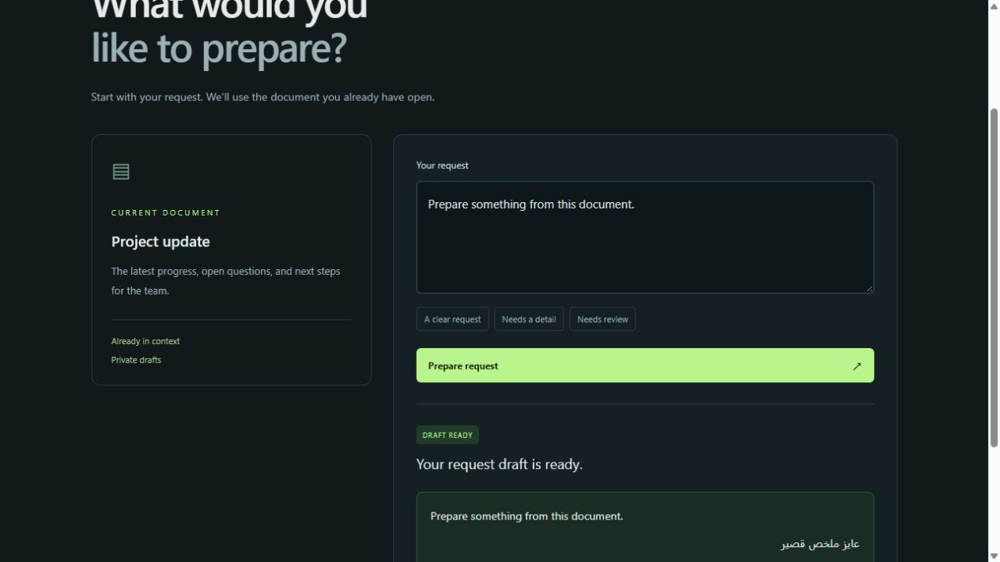

# decilist

**Build decisions you can test, compare, and run on your own machine.**

Decilist is an early, open-source Decision Intelligence SDK. Ask a bounded question directly in your code, validate its answer, apply a policy, and evaluate the result through the same contract across providers. It is local-first and model-agnostic by design. No decision registration or Playground session is required; reusable decision definitions are an optional future convenience.

**Status: measured local alpha.** Direct SDK calls, an explicit runtime launcher, packaged UI, and reproducible evaluation are implemented. Liquid d1-3B runs locally on the tested Windows RTX 3090. Its general held-out evaluation exposed substantial decision errors: 66.7% accepted classification accuracy and 60% overall coverage. See the [actual model results and failures](docs/model-validation.md). The optional test-triage assistant now adds concrete failure facts, bounded implementation references, and explicitly labelled rules/model modes. See [the fresh triage evaluation and agent-run repair experiments](docs/triage-v2-results.md). The default `demo` provider remains labelled deterministic rules. OpenAI Decisions is planned. Packages are not published to npm or PyPI.



## Why this exists

Calling a model is one step. A developer still needs to decide what counts as a valid answer, when to abstain, which fallback may receive the input, and whether a new provider actually improves their workload.

Decilist's intended value is that complete development loop:

- `choose`, `predict`, and `score` share a versioned contract across Python, TypeScript, and HTTP.
- Runtime checks reject unknown categories, invalid distributions, and inconsistent answers.
- A local-only policy blocks remote providers before inference. Low confidence, invalid output, errors, and timeouts are visible in the attempt trace.
- Evaluation keeps accuracy, coverage, abstention, and latency separate. Unknown cost stays `null`.
- The same domain-neutral example runs in code and a local Playground.

This does not introduce a new trained model or claim a speed advantage over vendor APIs. Differentiation must be demonstrated by lower integration effort and better measured application decisions. See [architecture](docs/architecture.md) and [evaluation methodology](docs/evaluation.md).

## Start locally

For Python and the packaged UI, install Python 3.12 (minimum 3.11) and Git. Clone the repository and create a local environment:

```bash
git clone https://github.com/ibrahim119-IN/decilist.git
cd decilist
python -m venv .venv
```

Activate `.venv` (`.\.venv\Scripts\Activate.ps1` on Windows PowerShell, `source .venv/bin/activate` on Ubuntu), then install and start:

```bash
python -m pip install "./packages/python[server]"
python -m decilist runtime start --provider demo
```

If activation is unavailable, replace `python` with `.\.venv\Scripts\python.exe` on Windows or `.venv/bin/python` on Ubuntu.

Open **http://127.0.0.1:8765/demo** for a normal request-composer example, or **http://127.0.0.1:8765/** for the optional Playground. Keep this terminal open; Ctrl+C stops the runtime. The app asks one focused clarification in place, preserves its known context, and prepares a local request preview. It does not generate the requested summary or execute external actions. This loopback development server has no production authentication, API key, external fonts, analytics, or cloud inference. Dependency installation requires internet access; the default demo does not.

## Python SDK

Connect once and use direct calls. Run this example in another terminal using the same environment and the running rules runtime:

```python
import asyncio
from decilist import Client

async def main():
    async with await Client.connect() as decisions:
        result = await decisions.predict('{"complete":true,"valid":true}', "Is the workflow ready to proceed?")
        print(result.value if result.status == "accepted" else "Needs review")

asyncio.run(main())
```

Python can also run in process with `Decilist([provider])`. Both paths expose `choose(state, instructions, options)`, `predict(state, instructions)`, and `score(state, instructions, levels)`. Prediction returns a boolean with P(true) in `probabilities["true"]`; scoring returns a probability-weighted index of 2–10 ordered levels, starting at zero. See [runtime setup and direct integration](docs/runtime.md).

## TypeScript SDK

TypeScript also requires Node.js 22+. From the repository root, install and build the workspace:

```bash
npm ci
npm run build
python -m decilist runtime run --provider demo -- node examples/workflow.mjs
```

The last command starts or reuses a compatible Python runtime and runs the TypeScript example. The package is currently consumed from the workspace, not a public registry. For your own app, use the shared runtime from Start locally or launch the app with `runtime run`. A direct call looks like:

```ts
import { Decilist } from "@decilist/sdk";

const sdk = await Decilist.connect(); // verifies local runtime readiness once
const result = await sdk.choose(
  JSON.stringify({ complete: true, valid: true }),
  "Choose the next workflow action.",
  { proceed: "Ready", retry: "Transient error", review: "Needs a person" },
);
if (result.status === "accepted") {
  // value is typed as "proceed" | "retry" | "review"
  console.log(result.value);
}
```

The TypeScript SDK performs request and response validation. The Python runtime owns model loading, provider policies, and evaluation. The explicit launcher starts or reuses the correct runtime and stops only the runtime it owns. Native TypeScript model execution is not implemented; imports do not start a process or download anything.

## HTTP for other languages

`POST /v1/decisions`, with `Content-Type: application/json`:

```json
{
  "question": {
    "kind": "choose",
    "state": "{\"complete\":true,\"valid\":true}",
    "instructions": "Choose the next workflow action.",
    "options": {"proceed":"Ready","retry":"Transient error","review":"Needs a person"}
  },
  "policy": {"local_only":true,"min_confidence":0.7,"timeout_ms":5000}
}
```

The demo's rules only implement the documented workflow gate; they do not interpret arbitrary prompts. Generated OpenAPI is served at `/openapi.json`, with a checked-in copy in [contracts/openapi.json](contracts/openapi.json).

## Inspect a failing test in an existing project

The optional Python triage helper consumes your existing failure log, extracts observed facts, and follows bounded static Python references to implementation code. It proposes an inspection when a narrow error-pattern rule or the learned local model supports it. Rules and model results remain distinguishable. It does not execute commands or repair files.

```bash
decilist triage --log failure.log --project .
```

Or call it directly from your existing Python tooling:

```python
from pathlib import Path
from decilist.triage_assistant import diagnose
from decilist.triage_evidence import prepare_evidence

evidence = prepare_evidence(Path("failure.log").read_text(), project=Path("."))
report = await diagnose(evidence, project=Path("."))  # inside your existing async function
print(report["next_check"]["title"])
```

Use `--mode rules` for facts and narrow rules without a model; `--mode model` explicitly bypasses rules. The default `auto` applies a supported rule first, otherwise requests the already-running learned local model. The `demo` runtime is rejected as a learned provider. `python -m decilist triage` is the equivalent module command; the original `decilist.triage` module remains available for reproducing v1.

Transport is restricted to a local loopback endpoint. Credential filtering is heuristic, so inspect evidence before sharing reports. The [Arabic install and integration guide](docs/install-and-use-ar.md) covers the few-line API, status handling, and setup. The [walkthrough](docs/triage.md) explains evidence limits. The [deferred human experiment](docs/triage-study.md) remains unstarted; separate agent-run trials measure actual agent time to a protected repair, without claiming human time savings.

**Triage quality remains limited.** The [original result](docs/triage-results.md) is preserved: Liquid suggested one next check and abstained on seven known cases. On eight fresh evaluation regressions, v2's learned path accepted two correct next checks versus one for v1, at the unchanged 0.7 threshold. The default hybrid also accepted two (one explicit rule, one model result). All three ambiguity/mixed/insufficient controls went to review in v2. These small authored suites do not establish general diagnosis quality or human productivity savings. [Full results and retained failures](docs/triage-v2-results.md).

The separate experimental **V5 verification workflow** gathers executed Python function context, proposes a small intervention with a local coding model, and reruns unchanged target and regression tests in a disposable copy. It leaves the original project untouched unless explicitly invoked with `--apply`. Use it directly from a terminal or Python API in an existing trusted project; no Playground or new form is required. See the [V5 quickstart](docs/triage-v5-quickstart.md), [measurement protocol](docs/triage-v5-experiment.md), and [actual results](docs/triage-v5-results.md). V5 verified **2/6** fresh evaluation repairs. The assisted agent median was **67.875s versus 58.703s** with ordinary tools; all four hints failed and agents continued manually. Both arms ultimately repaired all four reserved cases. The prespecified quality and time targets failed. Passing selected tests supports an intervention; it does not establish complete correctness or human debugging-time savings. [V4's negative results](docs/triage-v4-results.md) remain available unchanged.

## Verify and compare

Contributors also install the test/build dependencies. From the repository root with `.venv` active:

```bash
python -m pip install -c requirements-dev.lock -e "./packages/python[server,dev]"
npm ci
python scripts/restore_triage_v5_fixture_evidence.py
python -m pytest -q
npm test
python -m benchmarks.run --output reports/local/workflow.json
```

[CI for V5 and portable fixture evidence](https://github.com/ibrahim119-IN/decilist/actions/runs/40373453349) passed on Windows and Ubuntu, including the full test suite, package build and Python/TypeScript HTTP integrations. Native GPU inference was separately verified on the Windows presentation machine. First-use human usability remains unmeasured.

The original 12-case smoke suite checks wiring. Its perfect rule score follows from rules implementing its labels; it is **not** model-quality evidence. [Initial measured report](reports/baseline-2026-10-25.json).

The [new text suite](docs/evaluation-v2.md) has 20 development and 40 held-out cases across all three operations, with frozen labels and policy. It reports classification accuracy, numeric score error, coverage, abstention, validity, latency, and failure cases. The [Liquid report](benchmarks/results/request-text-liquid.json) records three repetitions of each case. The original rules do not implement this different task, so no misleading numeric comparison is made. The [uniform reference report](benchmarks/results/request-text-uniform.json) is a baseline, not a model result.

## Repository map

| Path | Purpose |
| --- | --- |
| `packages/python` | Runtime, typed contracts, providers, HTTP client, evaluation |
| `packages/typescript` | Typed SDK, validation, HTTP transport |
| `apps/api` | Thin repository entry point to the installed server |
| `packages/python/src/decilist/static` | Optional Playground and normal-app example |
| `contracts` | Shared parity cases and OpenAPI |
| `examples` | Domain-neutral workflow gate |
| `benchmarks` | Smoke/text evaluations, isolated triage regression lab, deferred study |
| `docs` | MVP plan, architecture, provider compatibility, licensing |

## License and roadmap

Decilist's own code is **Apache-2.0**. Model weights and vendor code are not included and retain their own terms. Liquid d1-3B is open-weight under the LFM Open License, not automatically covered by our code license. See [third-party terms](THIRD_PARTY.md) and the [Liquid setup gate](docs/providers.md).

The first presentation target is **Sunday, November 1, 2026**, Cairo time. The [implementation plan](docs/mvp-plan.md) prioritizes real local inference, direct SDK integration, simpler runtime setup, one optional Playground workspace, and a normal-app demonstration. See also the [demo walkthrough](docs/demo.md) and [contributing](CONTRIBUTING.md).
